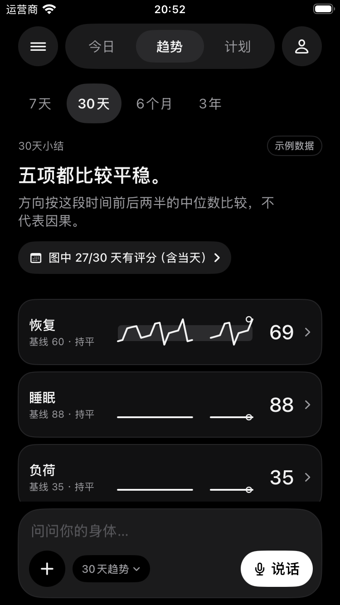
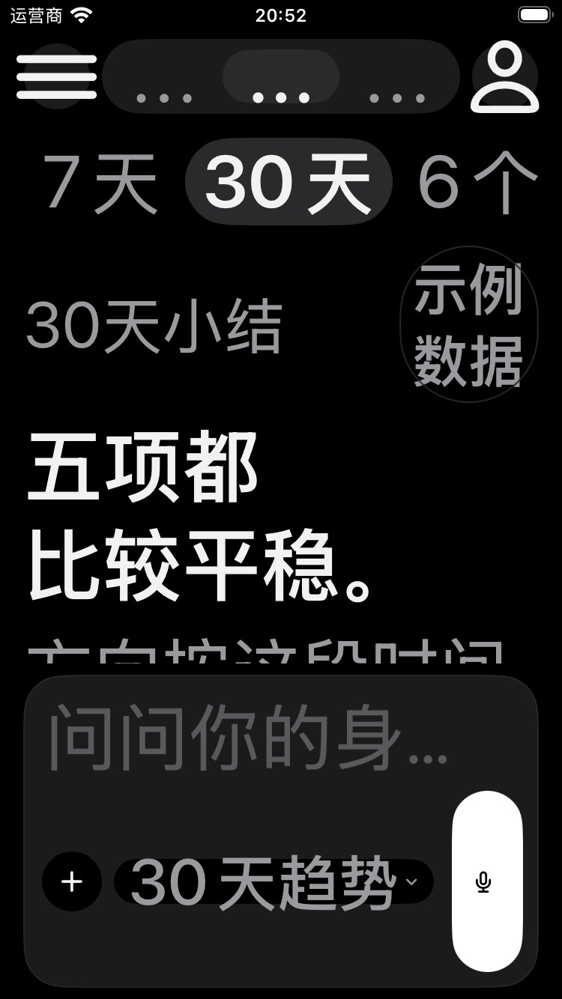
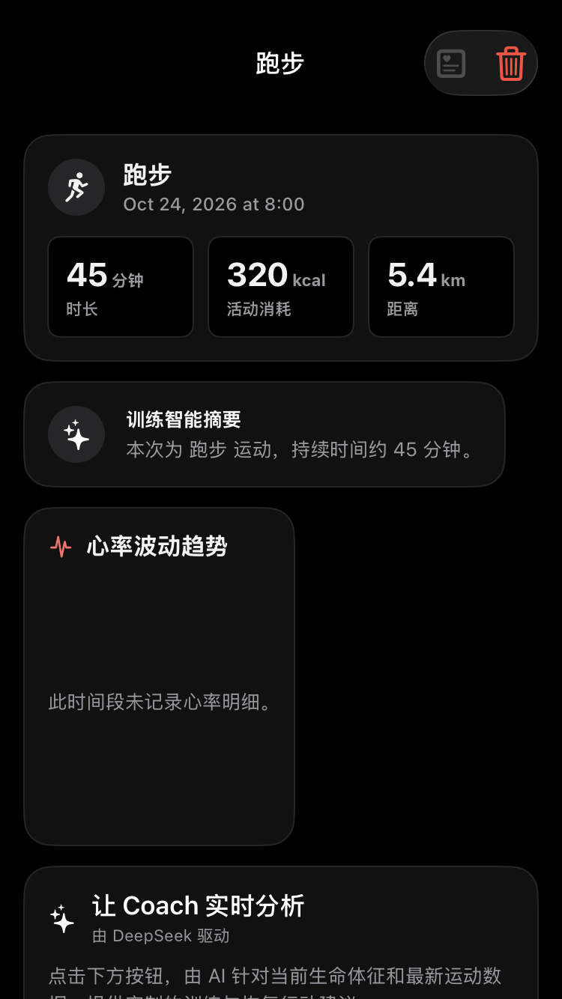
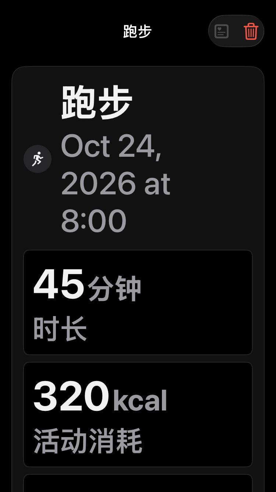
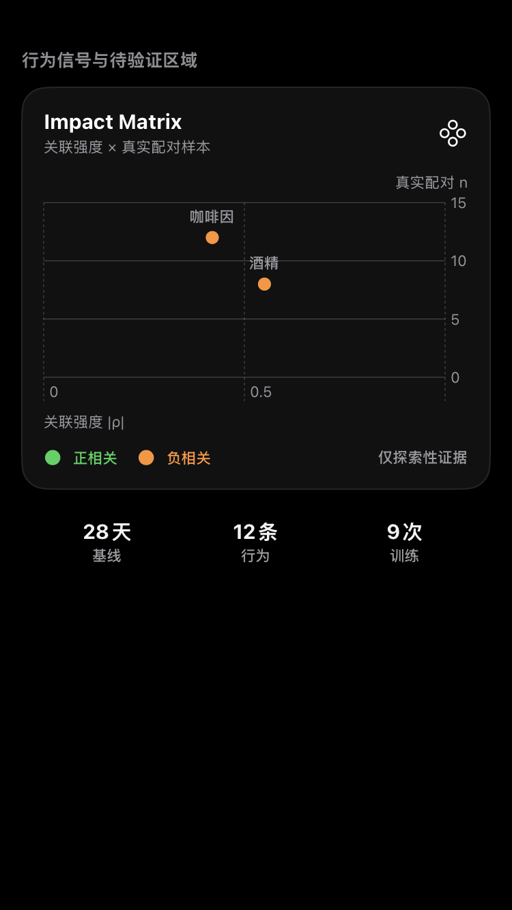
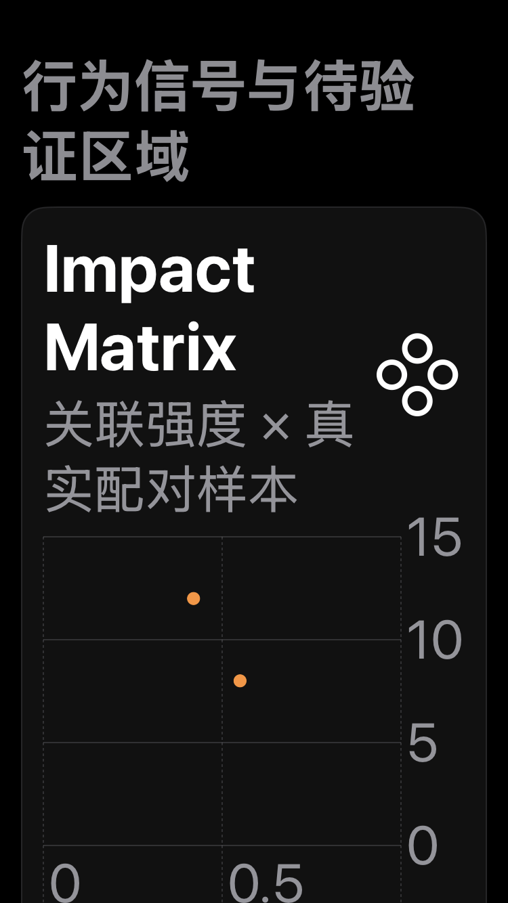
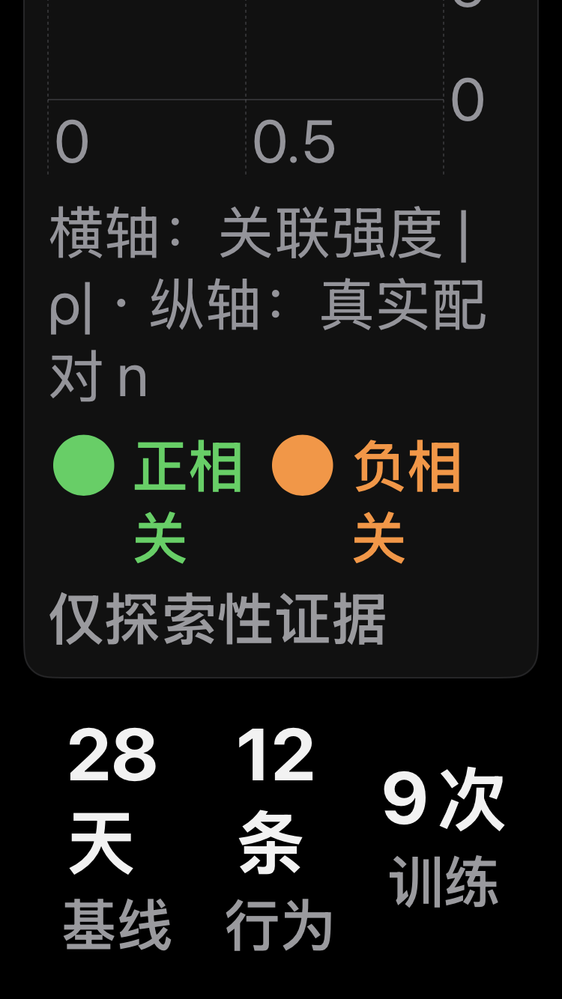

# Visual Body wave24 — Design D：全仓数字圆角扫荡 / MetricPill / AX 密度

- 分支：`cursor/visual-body-wave24-20261024`
- 基线：**stacks on #24 + #25**；wave23 tip **`f9afa3b5`**（= draft PR #25 head）。PR base = `main`，因此 GitHub diff 含 #24/#25 + 本波增量；review 请以相对 `f9afa3b5` 的 delta 为准。
- 日期：2026-10-24
- 性质：**visual-only**。无评分公式、schema、HealthKit、Store、导航 IA、对话历史列表行为、顶栏分段语义、AskBar mic 布局改动。
- 范围：MUST #1–#5（全仓 chrome 数字圆角 / `VelaMetricPill` / DS 图标 tile / AX 密度 / soft chrome 抽检）+ 能盖到的 SHOULD #6–#8。

## 环境

| 项 | 值 |
| --- | --- |
| Xcode | 27.1 (27A9275)（仓库 pin 26.5.0，与 #20/#23/#24/#25 同一已知不一致，未改 CI） |
| 模拟器 | `BodySeek Wave21 Disposable`（iPhone SE 3rd gen 375pt / iOS 26.5 23F77，已 boot） |
| 构建 | Debug，`CODE_SIGNING_ALLOWED=NO`，`-derivedDataPath build/DerivedData` |
| 语言 | `-testLanguage zh -testRegion CN` |
| 数据 | `-velaPreviewDashboard` 合成样例（非临床证据）；hosted 快照为 isolated in-memory container |

## 量级 / Diff metrics（相对 #25 tip `f9afa3b5`）

| 指标 | before | after |
| --- | --- | --- |
| **本波触及文件数字圆角**（21 个 VelaApp 源文件，其中 19 个含数字圆角；`cornerRadius: <literal>`，含 Path） | 48 | **3**（全部为 `VelaChart` 数据 mark 1/3/4pt） |
| **全仓 VelaApp `cornerRadius: <literal>`**（RoundedRectangle + Path） | 71 | **26** = 14 数据 mark + 12 brief-SKIP 文件 |
| **全仓 VelaApp `RoundedRectangle(cornerRadius: <literal>)`**（#25 同口径） | 69 | **24** = 13 数据 mark + 11 SKIP 文件 |
| **chrome 数字圆角（可触范围 = 非数据 mark、非 SKIP 文件）** | **45** | **0** |
| 保留的数据 mark（非 chrome，见清单） | 14 | 14 |
| `VelaMetricPill` tint wash 调用点（9 个调用点中的 wash 面） | 9 | **0**（改为 foreground-only tint + mono mist/hairline chrome） |
| DS 内 tint/mist 图标 wash（VelaCard + VelaFeedback + 追加的 VelaChart/VelaDesignSystem） | 8 | **0** |
| 0.75pt `rhythmMist` 卡框 soft 描边（VelaChart / TrendsOneMetricChart） | 2 | **0**（→ `hairline` 1pt） |
| `.velaNativeCard(radius: <literal>)` | 0 | 0 |
| `.ultraThinMaterial`（App 内） | 0 | 0 |
| `design: .rounded` | DS 1（SF Symbol 图标）+ `VelaMetricDetailWidgets` 11（brief SKIP） | 同左，书面 SKIP |
| 固定字号（`check_fixed_fonts.py` 站点） | 179 / 阈值 216 | **179**（未新增文本固定字号） |
| `audit_design_tokens.sh` 合计 | 589 | **585**（`RoundedRectangle` 412→408：4 处 CTA 改 `Capsule()`） |
| schema fingerprint | 32 live / 32 frozen V3 | 32 / 32（未变） |

## 改动分组 / Surface checklist

### MUST #1 — 全仓 chrome 数字圆角扫荡（VelaApp，不含 Watch/Widget）

**先 `git grep` 出 71 处字面量清单，再按文件分类**：45 处 chrome → 5-token，14 处数据 mark 保留，12 处在 brief 明确 SKIP 的 `VelaMetricDetailWidgets`。映射规则（全部既有 token，无新 token）：

- 卡片 / 面板 / 三列指标卡 / 空态卡 16–24 → `radiusCard`（18）
- 内嵌小面 / 图标 tile / chip / 分段控件 7–12 → `radiusSm`（8）
- 主 CTA（`TodayTrainingPlanAdaptationCard`「确认完成 / 先不了」、`VelaMinimalJournalView` 回填 CTA）→ `Capsule()`
- 图表卡内嵌 plot 面 16 → `radiusSm`，外卡 20 → `radiusCard`
- chrome soft 描边 `rhythmMist 0.75pt` / `lineWidth: 1` → `hairline` / `hairlineWidth`

触及文件（21）：`VelaCard`、`VelaChart`、`VelaDesignSystem`、`VelaFeedback`、`VelaInput`、`WikiProfileView`、`JournalCorrelationSection`、`JournalEntryCard`、`JournalTagInsights`、`MetricEvidenceSection`、`MetricTrendsSection`、`PrivacyDataControlsView`、`TodayTrainingPlanAdaptationCard`、`VelaJournalView`、`VelaMinimalComponents`、`VelaMinimalFitnessView`、`VelaMinimalJournalView`、`VelaMinimalShell`、`MetricCoachCard`、`WorkoutDetailView`、`TrendsOneMetricChart`。

**保留的数据 mark（14，逐处核验为数据/语义 mark，非 chrome）**：

- `VelaChart.swift` 284 / 314 / 458：stage interval bar 3pt、sparkline bar 1pt、range band 4pt
- `BodySeekInstrument.swift` 154：baseline tick `Path(roundedRect:cornerRadius: 1)`
- `TrainingHeroSection.swift` 959 / 979 / 985 / 989 / 1291：heatmap 图例 swatch 2.5pt、训练日 heatmap cell 6pt、训练量 bar 3pt
- `TrainingStatsSection.swift` 515 / 577 / 580 / 984：训练负荷 heatmap cell 3.5pt、sets 进度条 3pt、目标区间 band 4pt
- `VelaTrendsView.swift` 454：score band 图例 swatch 2pt

另有 2 处**函数式**数据 mark 不在 `cornerRadius: <literal>` 清单内（BarMark `.cornerRadius(1.5)` / `.cornerRadius(4)`，`WorkoutDetailView` 心率柱与 `MetricChartSection` 柱），同为数据 mark，保留。

**按 brief SKIP**：`VelaMetricDetailWidgets.swift` 12 处字面量未动（Watch/Widget/工具性文件，out of scope）。

### MUST #2 — `VelaMetricPill` tint wash（共享 DS）

- `tint.opacity(0.12)` wash → 实色 `rhythmMist` 胶囊 + `hairline` 1pt 描边。
- `tint` 改为 **foreground-only**：新增 icon `foregroundStyle(tint)`，默认 `rhythmInk`。9 个调用点逐一审计：全部为 `rhythmInk` / `accent`（= ink），`DataCoverageView` 的 `coverageColor(pct)` 亦返回 ink/accent，无状态彩色语义 → 全部保持 mono；无 API 删除、无调用点改动。
- 文字仍为 `muted` label + `fg` value，mono。

### MUST #3 — DS 图标 tile / EmptyState 残留（#25 点名 SKIP 项）

- `VelaEvidenceRow`：32pt 图标 tile 的 `tint.opacity(0.09)` + 10pt 半径 → `rhythmMist` + `radiusSm`；icon `foregroundStyle(tint)` 保留数据/状态语义。
- `VelaEmptyStateCompat`：44pt 图标圆 `tint.opacity(0.12)` → `rhythmMist` 实底 + `hairline` 圆描边；icon tint 保留。
- `VelaMakeIconTile`：`size * 0.25` 比例半径 → `radiusSm`（既有 5-token；未加新 token）。
- 调用点（EvidenceRow ×1 / EmptyState ×1 / MakeIconTile ×4）无 API 变更。

### MUST #4 — AX 密度（#25 观察项，visual-only）

**`WorkoutDetailView` hero 三列指标**
- 新增 `@Environment(\.dynamicTypeSize)`；AX（`isAccessibilitySize`）下 `LazyVGrid` 由 3 列变 **1 列**，数值不再被省略号吞掉。
- `heroMetric`：value `minimumScaleFactor` AX 下限 0.85（非 AX 保持 0.6），unit 0.85；title AX 允许 2 行 + `fixedSize(vertical:)`。
- **不改**数据字段、单位、顺序、导航、`WorkoutSummary` 投影。

**`JournalCorrelationSection` Impact Matrix**
- AX 下隐藏 per-point habit annotation（点标注互相/与轴标签重叠），图表高度 190→280；轴标签 `关联强度 |ρ| / 真实配对 n` 换成可换行的 caption「横轴：关联强度 |ρ| · 纵轴：真实配对 n」。
- 每个 PointMark 增加 `accessibilityLabel`/`accessibilityValue`（habit → outcome、ρ、n），信息不丢。
- 图例 `ViewThatFits`：横向放不下时自动纵排。
- **不改**散点数据、`ImpactMatrixBuilder`、正/负相关与 confidence 语义色。

### MUST #5 — 残留 soft chrome 抽检

- `VelaFeedback`：`MessageBubble` 未完成提示条 `rhythmMist.opacity(0.45)` → 实色 `rhythmMist` + `radiusSm`；状态图标圆 `state.tint.opacity(0.10)` → `rhythmMist`；`VelaInlineAlert` 卡框 `tint.opacity(0.08)` → `rhythmMist`（hairline 已有）。
- `VelaChart` / `TrendsOneMetricChart`：卡片 0.75pt mist 描边 → `hairline` 1pt。
- `WorkoutDetailView`：hero 活动图标 `workoutAccentColor.opacity(0.14)` 圆 wash、智能摘要 sparkles `rhythmMist.opacity(0.8)` → 实色 `rhythmMist`（语义前景保留）。
- `JournalCorrelationSection` 校准 chip：选中态 `accent.opacity(0.15)` wash → `rhythmMist` + `rhythmInk` hairline 描边，文字 `rhythmInk`。
- DS 追加：`VelaChart` 时间线图标圆 `item.domain.color.opacity(0.10)` → `rhythmMist`（domain 前景保留）；`VelaDesignSystem` `CoachArtifactCard` 图标 tile `accent.opacity(0.12)` → `rhythmMist`（foreground 保留）。
- `TrendsOneMetricChart`：plot 底 `rhythmCanvasRaised.opacity(0.7)` → 实色 `surfaceInset`（既有 inset token）。
- 抽检结论：App 内 `.ultraThinMaterial` = 0；剩余 `LinearGradient` 全部为图表/路线数据填充或既有 token 定义，无「非数据渐变当 chrome」的主表面调用点；剩余 Today ring 的 0.75pt mist 描边属 Today 既有环 chrome（非卡框，本波表面范围外，未动）。

### SHOULD #6–#8

- **#6 审计**：4 个脚本 + schema + contrast 全跑，见下表；PR 写全仓数字圆角 before→after。
- **#7 新增 `testVisualBodyWave24Snapshots`**：
  - UI（`VelaSmokeUITests`）：Trends dark + AccessibilityXXXL（2 张）；
  - hosted（`VelaThemeTests`）：WorkoutDetail hero dark + AX、Journal Impact Matrix dark + AX（4 张）；
  - 共 7 张证据（含 Journal AX 滚动态，覆盖 fold 以下的 legend/轴 caption），覆盖 MUST #4 的两个 AX 表面。
- **#8 书面确认 SKIP**：Watch/WidgetKit（含 `VelaMetricDetailWidgets`）11×`.rounded` 全部未动；`VelaDesignSystem` 唯一 `design: .rounded` 为 `Image(systemName:)` 图标字（SF Symbol 不参与 Dynamic Type），未动；品牌 wordmark/ring 的比例字号未动；无新 palette / 装饰 glow / 渐变描边 / material chrome。

## 命令与退出码

| # | 命令 | 结果 | exit |
| --- | --- | --- | --- |
| 1 | `xcodebuild build -project Vela.xcodeproj -scheme Vela -configuration Debug -destination 'generic/platform=iOS Simulator' -derivedDataPath build/DerivedData CODE_SIGNING_ALLOWED=NO` | **BUILD SUCCEEDED**，0 warnings | 0 |
| 2 | `xcodebuild test ... -only-testing:VelaTests` | **TEST SUCCEEDED**：Executed **680** tests / 0 failures（wave23 679 + 本波新增 hosted snapshot 1） | 0 |
| 3 | `xcodebuild test ... -only-testing:VelaUITests/VelaSmokeUITests/testVisualBodyWave24Snapshots`（本波新增） | **passed**：1 test / 0 failures（12.6s） | 0 |
| 4 | `xcodebuild test ... -only-testing:VelaUITests/VelaSmokeUITests/{wave22,residual,nextWave,upgrade}` | **4/4 passed**（194.9s） | 0 |
| 5 | `python3 scripts/check_fixed_fonts.py --strict` | 179 / 阈值 216（与 wave23 持平，本波未新增文本固定字号） | 0 |
| 6 | `bash scripts/audit_design_tokens.sh` | `Color(hex:)` 0、`RoundedRectangle` 408（wave23 412）、合计 **585**（wave23 589） | 0 |
| 7 | `python3 scripts/check_contrast.py` | 通过（textColor / deviationInk ≥4.5:1） | 0 |
| 8 | `python3 scripts/schema_fingerprint.py --check` | 通过（schema 未变：32 live / 32 frozen V3） | 0 |
| 9 | `xcrun swiftc -parse <23 个改动 .swift>` | 全部 exit 0、无输出 | 0 |
| 10 | `git diff --check` | 通过 | 0 |

原始证据：[`build-success.txt`](build-success.txt)、[`unit-tests.txt`](unit-tests.txt)、[`ui-wave24.txt`](ui-wave24.txt)、[`ui-regression.txt`](ui-regression.txt)、[`radius-before-all.txt`](radius-before-all.txt)、[`radius-after-all.txt`](radius-after-all.txt)、[`radius-chrome-before.txt`](radius-chrome-before.txt)、[`radius-data-marks-retained.txt`](radius-data-marks-retained.txt)、[`radius-skipped-file.txt`](radius-skipped-file.txt)、[`design-token-before.txt`](design-token-before.txt)、[`design-token-after.txt`](design-token-after.txt)、[`fixed-font-before.txt`](fixed-font-before.txt)、[`fixed-font-after.txt`](fixed-font-after.txt)、[`contrast-after.txt`](contrast-after.txt)、[`schema-fingerprint-after.txt`](schema-fingerprint-after.txt)、[`changed-files.txt`](changed-files.txt)、[`worktree-status.txt`](worktree-status.txt)、[`base-head.txt`](base-head.txt)。

测试结果摘要（`xcresulttool get test-results summary`）：

| result bundle | result | total | passed | failed |
| --- | --- | --- | --- | --- |
| `wave24-unit.xcresult`（VelaTests） | Passed | 680 | 680 | 0 |
| `wave24-ui.xcresult`（wave24 UI snapshots） | Passed | 1 | 1 | 0 |
| `wave24-regression.xcresult`（#22/#23/#24 回归） | Passed | 4 | 4 | 0 |

## 截图 / Screenshots（Dark / SE 375pt / iOS 26.5 / 合成样例）

| 表面 | 证据 |
| --- | --- |
| Trends 首屏（chrome token 化后） |  |
| Trends AccessibilityXXXL（顶栏分段收敛属 #17–#25 既有行为，未动） |  |
| WorkoutDetail hero（常态 3 列；图标 tile mono mist；卡 token） |  |
| WorkoutDetail hero AccessibilityXXXL（**1 列，数值不省略**） |  |
| Journal Impact Matrix（散点/标注/语义色保留；卡 token） |  |
| Journal Impact Matrix AccessibilityXXXL（**标注不重叠**；隐藏点标注、加高 plot） |  |
| Journal Impact Matrix AccessibilityXXXL 滚动态（**legend ViewThatFits 纵排 + 轴 caption**，667pt fold 下移后） |  |

## AX 观察（AccessibilityXXXL）

- **WorkoutDetail hero**：AX 下三列 → 单列，`45 分钟 / 320 kcal / 5.4 km` 完整显示，不再出现省略号（#25 列为下一波的 pre-existing 问题已修）。
- **Journal Impact Matrix**：AX 下点标注互不重叠、不与轴标签碰撞；散点仍为 2 点（咖啡因 n=12 / 酒精 n=8），正/负相关语义色保留；VoiceOver 通过 mark labels 仍可读到配对与 ρ/n。
- **Trends**：内容与顶栏行为与 wave23 一致；AX 下顶栏分段收敛为圆点是 #17–#25 既有顶栏行为（out of scope，本波未动），截图为证。
- hosted 截图使用 `.accessibility5`（比 AX XXXL 更强）验证同一布局分支。

## 有意保留的数据语义色 / 厚边（Design D 允许）

- Impact Matrix 散点（正/负相关 success/warn）+ 图例、confidence 语义色、baseline 数据带。
- Trends / 详情图表：AreaMark/LineMark/RuleMark/BarMark 及其 1–6pt 数据 mark 圆角、sparkline 数据点、score band 图例 swatch。
- WorkoutDetail：心率 Chart 数据 mark/轴 chrome、MapPolyline 路线、GPS 起终点、心率区间语义色、活动类型语义色（icon foreground）。
- 状态/错误/破坏性语义色（workout 删除 `systemRed`、状态 icon tint）。
- Watch / WidgetKit / `VelaMetricDetailWidgets` 全部未动。

## 刻意跳过（SKIP）

- Watch / WidgetKit / `VelaMetricDetailWidgets`（brief Out of scope；12 处数字圆角、11 处 `.rounded` 未动）。
- 评分公式 / schema / HealthKit / Store / 导航 IA / Dock / 历史列表行为 / Today 五分横条 / Speak pill / chips / 顶栏分段语义 / AskBar mic 布局。
- `VelaDesignSystem` 唯一 `design: .rounded`（SF Symbol 图标字）；品牌 wordmark/ring 数字比例字。
- Today ring 的 0.75pt mist 内描边与 Today 二级表面（非本波表面）。
- `.velaNativeCard(radius:)` 已为 0，无动作。
- 未做真机、Reduce Motion、VoiceOver 全量、iOS 17 最低版本、全量 UI 套件（CI 会跑）、Watch/Widget 构建验证。

## 风险 / 未验证

- 视觉变化为 SwiftUI 截图人工核对（dark/AX + 7 张证据），未做像素级 diff。
- 45 处 chrome 半径收敛到 5-token 属有意视觉变化；布局语义、可点击区域、数据字段与导航未改。
- `VelaMetricPill` 的 tint 从整颗 wash 收为 icon foreground-only：现有 9 个调用点全为 ink/accent（mono），故视觉上仅去 wash、不引入彩色；若未来新增状态语义 tint 调用点，需保持「仅状态色，默认 ink」约定。
- AX 修复以 `dynamicTypeSize.isAccessibilitySize` 分支实现；常规字号渲染路径仅移除半径字面量，未改密度。
- 工具链不一致：本机 Xcode 27.1（仓库 pin 26.5.0，与 #20/#23/#24/#25 同样未改 CI）；未声称 pinned 工具链 CI 通过。
- 未 force-push 任何既有 wave 分支；wave22/#24、wave23/#25 分支与历史未动。
